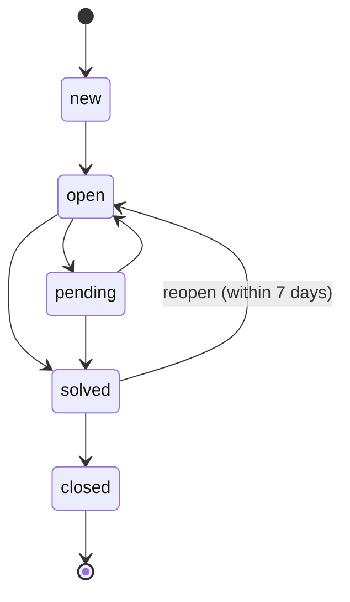

# API reference

The authoritative contract is [`openapi.json`](../openapi.json) (also served at `/openapi.json`,
with interactive docs at `/docs`). This page explains the conventions the contract does not.

All business endpoints live under `/v1`. Operational endpoints (`/healthz`, `/readyz`,
`/metrics`) are not versioned and not in the OpenAPI document.

## Operations

102 operations, each with an `operationId` of the form `<domain>_<verb>`.

| Domain | Count | Examples |
|---|---|---|
| customers | 9 | `customers_list`, `customers_create`, `customers_merge`, `customers_list_orders` |
| agents | 7 | `agents_list`, `agents_deactivate`, `agents_list_tickets` |
| teams | 8 | `teams_list_members`, `teams_add_member`, `teams_set_oncall` |
| tickets | 17 | `tickets_list`, `tickets_assign`, `tickets_escalate`, `tickets_merge`, `tickets_close`, `tickets_reopen`, `sla_evaluate_ticket` |
| comments | 4 | `comments_add_reply` (public), `comments_add_note` (internal) |
| tags | 3 | `tags_list`, `tags_create`, `tags_delete` (ticket tagging is under tickets) |
| orders | 8 | `orders_list`, `orders_get`, `orders_ship`, `orders_deliver`, `orders_cancel` |
| refunds | 6 | `refunds_create`, `refunds_approve`, `refunds_reject`, `refunds_cancel` |
| sla | 5 | `sla_policies_list`, `sla_list_breaches` |
| macros | 6 | `macros_list`, `macros_apply` |
| knowledge-base | 8 | `kb_articles_search`, `kb_articles_publish` |
| webhooks | 7 | `webhooks_create`, `webhooks_test`, `webhooks_list_deliveries` |
| reports | 5 | `reports_ticket_volume`, `reports_sla_compliance`, `reports_agent_workload`, `reports_csat_summary`, `reports_backlog` |
| audit | 2 | `audit_list_events`, `audit_get_event` |
| admin | 7 | `admin_whoami`, `admin_settings_update`, `admin_api_keys_create` |

Summaries and descriptions are written for a reader that has never seen the API (including AI
agents): what the call does, when to use it, and the parameters that matter. A test enforces
that every operation has them.

## Authentication

Send an API key as a bearer token:

```
Authorization: Bearer hd_1a2b3c4d_<secret>
```

- A key is `hd_<prefix>_<secret>`. The server stores the prefix (for lookup) and
  `sha256(salt + secret)` with a random per-key salt. The plaintext token is shown once, when the
  key is created.
- A key has **scopes**. `admin` grants everything. Otherwise a route requires specific scopes
  and all of them must be present.
- A key can be linked to an **agent**. That link matters for one rule: only a key linked to an
  agent with role `lead` can approve or reject refunds.
- Keys can expire and can be revoked. A deactivated agent's keys keep working but lose the agent
  link, so they cannot approve refunds.

| Scope | Allows |
|---|---|
| `tickets:read`, `tickets:write` | Tickets, comments, tags, ticket history, CSAT |
| `customers:read`, `customers:write` | Customers |
| `orders:read`, `orders:write` | Orders |
| `refunds:read`, `refunds:write` | Refunds |
| `agents:read`, `agents:write` | Agents, teams, on-call |
| `sla:read`, `sla:write` | SLA policies and breaches |
| `macros:read`, `macros:write` | Macros |
| `kb:read`, `kb:write` | Knowledge base |
| `webhooks:read`, `webhooks:write` | Webhooks |
| `reports:read` | Reports |
| `audit:read` | Audit log |
| `admin` | Everything, including settings and API keys |

Some routes need two scopes, for example listing a customer's tickets needs
`customers:read` and `tickets:read`.

Create the first key from the command line (it needs database access, not the API):

```bash
helpdesk create-api-key --name bootstrap --scopes admin
helpdesk create-api-key --name lead-bot --scopes refunds:write,refunds:read --agent A-0002
```

| Situation | Status | Problem type |
|---|---|---|
| No `Authorization` header, bad token, revoked or expired key | 401 | `unauthorized` |
| Key lacks a required scope | 403 | `insufficient-scope` (lists `required_scopes`, `missing_scopes`) |
| Refund decision without a lead agent key | 403 | `agent-role-required` |

## Errors

Every error is `application/problem+json` ([RFC 9457](https://www.rfc-editor.org/rfc/rfc9457)):

```json
{
  "type": "https://helpdesk.example/problems/refund-not-eligible",
  "title": "Order is not eligible for a refund",
  "status": 422,
  "detail": "Order 'O-0002' is outside the 30-day refund window.",
  "instance": "/v1/refunds",
  "request_id": "9f0c2a7e5b6d4c3a8e1f0a2b3c4d5e6f",
  "window_days": 30
}
```

`type` is a stable identifier; match on it, not on `detail`. Extra members such as `window_days`
or `allowed` add context for specific problems. `request_id` equals the `X-Request-ID` response
header and appears in the server logs and in audit events. The `type` prefix is configurable
(`HELPDESK_PROBLEM_BASE_URI`); the URIs are identifiers and are not guaranteed to resolve.

| `type` (suffix) | Status | Meaning |
|---|---|---|
| `validation-failed` | 422 | Body or parameters invalid. `errors[]` lists `loc`, `msg`, `type` per field. Also used for rules like "assignee is deactivated". |
| `not-found` | 404 | The referenced entity does not exist (`entity`, `id` members). |
| `route-not-found` | 404 | No such path. |
| `method-not-allowed` | 405 | Wrong HTTP method for the path. |
| `conflict` | 409 | Duplicate email, closed ticket edited, wrong state for the action. |
| `invalid-status-transition` | 409 | Illegal ticket status step (`current`, `target`, `allowed`). |
| `reopen-window-expired` | 409 | Solved more than 7 days ago. |
| `policy-violation` | 422 | A well-formed request that a business rule forbids (for example merging tickets of different customers). |
| `refund-not-eligible` | 422 | Order status or refund window rule failed. |
| `refund-exceeds-balance` | 422 | Amount is more than what is left to refund (`refundable`). |
| `idempotency-key-reuse` | 422 | Same `Idempotency-Key`, different request. |
| `invalid-cursor` | 400 | Malformed pagination cursor. |
| `bad-request` | 400 | Other malformed requests (for example an over-long idempotency key). |
| `unauthorized`, `insufficient-scope`, `agent-role-required` | 401 / 403 | See Authentication. |
| `not-ready` | 503 | `/readyz` cannot reach the database. |
| `internal-error` | 500 | Unexpected failure. The body never contains internals; use `request_id` to find the log line. |

## Pagination

List endpoints use cursors:

```
GET /v1/tickets?status=open&limit=25
```
```json
{ "items": [ ... ], "next_cursor": "WyJkdCIsIjIwMjYtMDUt..." }
```

Pass `next_cursor` back as `cursor` to get the next page; it is `null` on the last page.
`limit` is 1 to 100 (default 25). Cursors are opaque, tied to the same filters and sort order,
and stable when new rows are inserted while you page (keyset pagination on `(sort key, id)`).
Most lists are newest first. Comments are oldest first; agents and macros are ordered by id.
Each operation's description states its order. Short reference lists (teams, tags,
SLA policies, webhooks, API keys) return a plain array.

## Idempotency

Send `Idempotency-Key: <unique string up to 255 chars>` on any `POST`. Rules:

- The first request is processed normally. If it succeeds (2xx), its status and body are stored
  for 24 hours (`HELPDESK_IDEMPOTENCY_TTL_HOURS`).
- A repeat with the same key and the same method, path, query and body returns the stored
  response with header `Idempotent-Replayed: true`. Nothing is processed twice.
- A repeat with the same key but a different request returns 422 `idempotency-key-reuse`.
- Failed requests (4xx, 5xx) are not stored, so you can fix the problem and retry with the same key.
- Keys are scoped to the caller: the same key string used with a different API key is a
  different key.

Use it for anything that creates records or moves money, especially `refunds_create`.

## Business rules

**Refunds** (`refunds_create`)

1. The order must be `delivered` or `shipped`; otherwise 422 `refund-not-eligible`.
2. The refund must be requested within 30 days of delivery (a shipped order that has no delivery
   date uses its ship date). Configurable with `refund_window_days`.
3. `amount` must be at most the order total minus refunds that are `approved` or
   `pending_approval`. Rejected and cancelled refunds release their amount.
4. Amounts up to and including 500.00 are `approved` immediately. Larger amounts are created
   `pending_approval` (configurable with `refund_approval_threshold`).
5. A key linked to an agent with role `lead` approves or rejects (`refunds_approve`,
   `refunds_reject`). Any `refunds:write` key can cancel a pending refund.

**Ticket status machine**



Any other transition returns 409 `invalid-status-transition`. `tickets_close` is a shortcut that
solves and closes in one step from `open`, `pending` or `solved`. Closed tickets cannot be edited,
assigned, escalated, replied to or reopened. Assigning a `new` ticket moves it to `open`.

**SLA.** Each priority has a policy with a first-response and a resolution target in minutes.
Due times are stored on the ticket when it is created or re-prioritised. A first response is the
first public reply. A target is `met` if achieved by its due time, `breached` if achieved late or
still open past due, `at_risk` when less than 20% of the window remains, `pending` otherwise.
Escalating raises priority one step (up to `urgent`), which tightens the targets for later
evaluation.

**Merge.** `tickets_merge` moves comments and tags to the target and closes the source.
`customers_merge` moves tickets, orders and refunds and marks the source `merged`. Both are
idempotent: repeating the same merge changes nothing and returns the survivor. Merging into a
different target than before returns 409.

**Audit.** Every write records `action`, `entity_type`, `entity_id`, the changed fields (`before`
and `after`), the API key, the linked agent and the `request_id`. Reads are not audited.

## Examples

```bash
export H="Authorization: Bearer $HELPDESK_KEY"
BASE=http://localhost:8000

# Find an open ticket that is breaching its SLA
curl -s "$BASE/v1/tickets?status=open&sla_breached=true&limit=5" -H "$H"

# Reply publicly, then escalate
curl -s -X POST "$BASE/v1/tickets/T-1042/replies" -H "$H" -H 'Content-Type: application/json' \
  -d '{"body":"We are looking into it."}'
curl -s -X POST "$BASE/v1/tickets/T-1042/escalate" -H "$H" -H 'Content-Type: application/json' \
  -d '{"reason":"Customer cannot work","team_id":"TM-005"}'

# Refund safely: retrying with the same key never refunds twice
curl -s -X POST "$BASE/v1/refunds" -H "$H" -H 'Content-Type: application/json' \
  -H 'Idempotency-Key: refund-O-1501-damaged' \
  -d '{"order_id":"O-1501","amount":"129.90","reason":"damaged"}'
```

## Not implemented

- Webhook **event delivery** (sending `ticket.created` and so on when things happen). Webhooks can
  be created and tested (`webhooks_test`), and subscriptions record the events they want, but
  the service does not yet dispatch events.
- Rate limiting, and authentication of customers (this is a staff-facing API).
