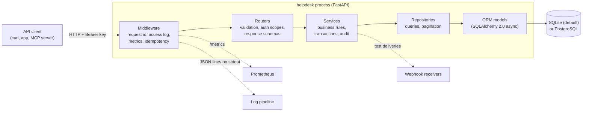
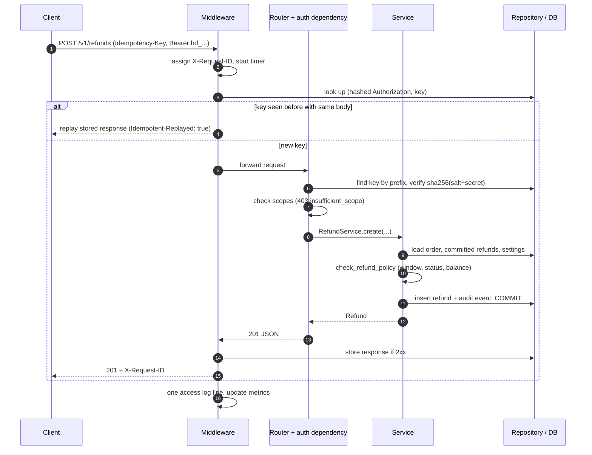
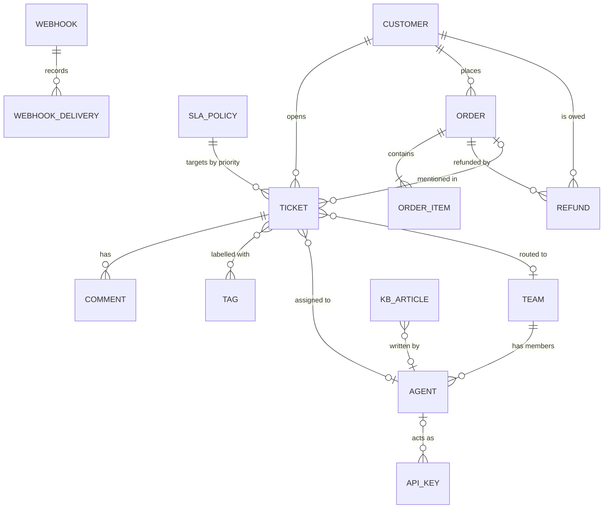
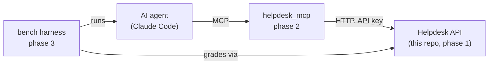

# Architecture

This page describes how the Helpdesk API is put together. The MCP server and the benchmark
(phases 2 and 3) are described at the end, because they sit on top of this service.

## Components

| Layer | Package | Allowed to depend on | Responsibility |
|---|---|---|---|
| Middleware | `helpdesk.api.middleware` | metrics, DB (idempotency only) | Cross-cutting HTTP behaviour |
| Routers | `helpdesk.api.routers` | schemas, services | Parse input, check scopes, shape output |
| Schemas | `helpdesk.api.schemas` | pydantic | The public contract (request and response types) |
| Services | `helpdesk.services` | repositories, models | Business rules, one transaction per operation, audit |
| Repositories | `helpdesk.repositories` | models | The only place that builds queries |
| Models | `helpdesk.models` | SQLAlchemy | Table definitions |

Routers never import ORM models: they receive objects from services and turn them into response
schemas with `Schema.model_validate(obj)`. Services raise typed errors from `helpdesk.errors`;
a single handler turns them into `application/problem+json` responses. The reasoning is in
[ADR 0001](adr/0001-layered-architecture.md).

## Request flow

Failures at any step raise a domain error; the exception handler converts it to a problem
document and the middleware still logs and counts the request.

## Data model

Plus three platform tables: `audit_events`, `idempotency_records`, and `sequences` (id counters
that give the `T-1042` style ids). `settings` holds runtime overrides of the business rules.

Notes:

- Ids are readable strings: `C-0311` customer, `T-1042` ticket, `O-5520` order, `R-0042` refund,
  `A-0007` agent, `TM-002` team, `CM-00123` comment, `KB-0012` article, `K-003` API key.
- Money is stored as integer cents and exposed as two-decimal strings (`"129.90"`).
- Timestamps are timezone-aware UTC everywhere. SQLite drops the time zone, so a column type
  restores it on read.
- A ticket stores its SLA due times (`first_response_due_at`, `resolution_due_at`) when it is
  created or its priority changes. Breach status is then computed from timestamps and can be
  filtered in SQL.

## Where the rules live

| Rule | Code |
|---|---|
| Ticket status machine, reopen window | `services/workflow.py` (pure functions) |
| Refund policy | `services/refund_policy.py` (pure function) + `services/refunds.py` |
| SLA evaluation | `services/sla.py` |
| Merge (tickets, customers) | `services/tickets.py`, `services/customers.py` |
| Audit recording | `services/base.py` (`BaseService.audit`) |
| Auth and scopes | `api/deps.py`, `security.py` |
| Idempotency | `api/middleware.py` |

## Transactions

Each service operation validates, mutates, writes its audit event and commits once. If anything
raises before the commit, the request's session is discarded and nothing is persisted (for
example a macro whose last action is an illegal status change leaves no partial comment behind).
Reads never commit.

## What comes next

The MCP server is a thin wrapper: it never touches the database and holds no business rules.
Tools are generated from `openapi.json`, which is why every operation carries a stable
`operationId`, a summary and a description written for an AI reader.
