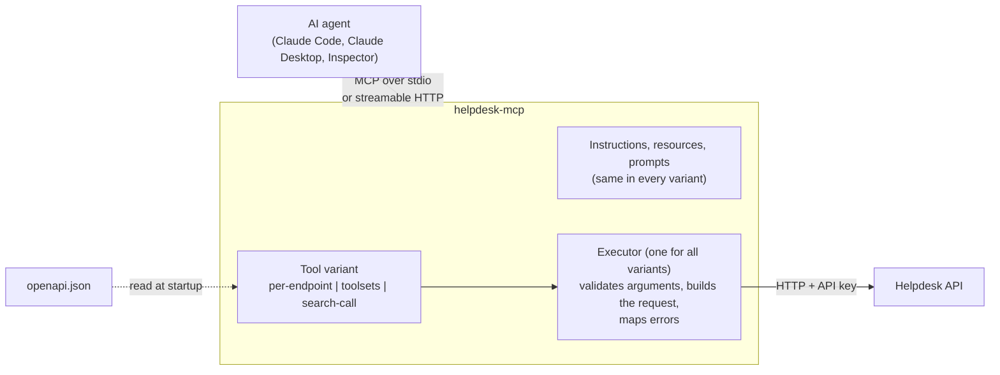

# MCP server

`helpdesk-mcp` lets an AI agent use the Helpdesk API through the
[Model Context Protocol](https://modelcontextprotocol.io). If you have never used MCP: the
agent connects to the server, asks what it offers, and gets back **tools** (things it can call),
plus optional **instructions**, **resources** (documents it can read) and **prompts** (ready-made
task templates). Everything the agent knows about the helpdesk comes from that text, so how it is
written and how many tokens it takes both matter.

The server is a thin layer over the HTTP API described in [api.md](api.md). It never touches the
database and holds no business rules: refund limits, the ticket status machine and the SLA maths
all stay in the API. See [ADR 0008](adr/0008-mcp-server-is-a-thin-http-wrapper.md).



## Quickstart

```bash
make install && make seed                 # once: database with synthetic data
make serve                                # terminal 1: the API on :8000
export HELPDESK_MCP_API_KEY=$(make -s key)   # terminal 2: a key linked to lead agent A-0002
make mcp VARIANT=search-call              # the MCP server over stdio
```

`make mcp` waits for a client on stdin, so on its own it looks idle. Use a client from
[Client configuration](#client-configuration), or `make inspector` (needs Node.js) to click
through it in a browser.

## What the server sends besides tools

Each of these is the same in all three variants and can be switched off, which is how the
benchmark measures what it is worth.

| Feature | What it is | Why it is there | Flag to turn off |
|---|---|---|---|
| **Instructions** | About 230 words sent once, when the client connects. | Tells the agent how the app fits together before it has called anything: tickets and orders belong to customers, refunds need an order and follow a policy, search before you write, what the IDs look like. Cheap, and it is read every session. | `--no-instructions` |
| **Resources** | Four documents the agent can read when it needs them: `helpdesk://schema` (entities, ids, value sets), `helpdesk://policies/refunds`, `helpdesk://policies/sla`, and the template `helpdesk://tickets/{ticket_id}` (one ticket as JSON). | Keeps long reference text out of the always-loaded context. The agent pays for it only when it reads it. | `--no-resources` |
| **Prompts** | Three task templates: `triage_ticket(ticket_id)`, `weekly_sla_report(team?)`, `refund_request(order_id, reason)`. | A person (or a client menu) can start a well-formed multi-step task in one action. Each lists the steps, names the operations to use, and says what not to do (for example, never approve your own refund). | `--no-prompts` |

With a flag set, the server also stops advertising the capability, so a client sees no
resources or prompts at all rather than empty lists.

The instructions and resource text is written to match what the API enforces; the numbers
(30 days, 500.00, 7 days, the SLA targets) come from the implemented rules in
`helpdesk.services`. If a rule changes in the API, update `src/helpdesk_mcp/content.py`.
A test keeps the instructions under 250 words.

IDs, as the API generates them: `C-0311` customer, `T-1042` ticket, `O-1502` order,
`R-0111` refund, `A-0002` agent, `TM-001` team, `KB-0001` article.

## The three tool designs

Choose one with `--variant`. All three reach the same 102 operations and return the same JSON
for the same call, because they share one executor
([ADR 0009](adr/0009-variants-share-one-executor.md)).

| | `per-endpoint` | `toolsets` | `search-call` |
|---|---|---|---|
| Tools | One per operation (102; `--tool-count` for a subset) | 8 domain tools | 3: `search_api`, `describe_operation`, `call_api` |
| Tool name | The `operationId`, e.g. `tickets_close` | `tickets`, `customers`, `orders_refunds`, `knowledge`, `team`, `sla_reports`, `admin`, `webhooks` | fixed |
| How a call looks | `tickets_close {ticket_id, note}` | `tickets {action: "close", params: {ticket_id, note}}` | `call_api {operation_id: "tickets_close", params: {...}}` |
| What the agent sees up front | Every operation, with full description and schema | Each action's summary and parameter names | Almost nothing; it must search |
| Built | Generated from `openapi.json` at startup | Hand-written mapping onto the same operations | BM25 index over the same operations |
| Cost up front | Highest, grows with the number of tools | Medium | Lowest |
| Cost per task | Lowest: one call | One call | At least two or three: search, (describe), call |
| Main risk | Many similar tools to choose between | `params` has no schema, so wrong names are only caught by the API | A weak search hides the right operation |

Approximate size of the tool list for each (full numbers, and how they were measured, are in
[tool-list-sizes.md](tool-list-sizes.md); tokens there are bytes divided by 4, not real token
counts):

| Variant | Tools | Model-visible size | ~Tokens |
|---|---:|---:|---:|
| per-endpoint, 10 | 10 | 6.3 kB | 1,600 |
| per-endpoint, 25 | 25 | 15.8 kB | 3,900 |
| per-endpoint, 50 | 50 | 30.5 kB | 7,600 |
| per-endpoint, 100 | 100 | 58.5 kB | 14,600 |
| per-endpoint, all | 102 | 59.7 kB | 14,900 |
| toolsets | 8 | 12.9 kB | 3,200 |
| search-call | 3 | 1.2 kB | 300 |

### per-endpoint

Each operation in `openapi.json` becomes one tool. Nothing is trimmed by hand, so what the
agent reads is what the API documents.

- **name** is the `operationId` (`refunds_create`).
- **description** is the operation's summary, a blank line, then its description. The
  descriptions are written for an AI reader in the API (see [api.md](api.md)).
- **input schema** merges everything the HTTP call takes into one flat object: path
  parameters, query parameters and the fields of the JSON body. Required fields from the
  parameters and the body are combined in `required`. Types, enums, limits and field descriptions
  are copied from the OpenAPI schemas. Referenced types move to `$defs` inside the tool's own
  schema, so each tool schema stands alone. `additionalProperties` is `false`.
  Body fields that clash with a parameter name would be ambiguous; there are none today and
  loading fails if one appears.
- **annotations** come from the HTTP method:

  | Method | `readOnlyHint` | `destructiveHint` | `idempotentHint` |
  |---|---|---|---|
  | GET | true | false | true |
  | POST | false | false | false |
  | PUT, PATCH | false | false | true |
  | DELETE | false | true | true |

  `openWorldHint` is always false: the server talks to one closed system.

`refunds_create`, as the agent sees it (abridged):

```json
{
  "name": "refunds_create",
  "description": "Request a refund for an order\n\nCreates a refund, enforcing the refund policy: ...",
  "inputSchema": {
    "type": "object",
    "properties": {
      "order_id": {"type": "string", "title": "Order Id"},
      "amount": {"anyOf": [{"exclusiveMinimum": 0.0, "type": "number"}, {"type": "string"}], "description": "Amount to refund."},
      "reason": {"type": "string", "minLength": 1, "maxLength": 2000},
      "ticket_id": {"anyOf": [{"type": "string"}, {"type": "null"}], "description": "Ticket this refund relates to."}
    },
    "required": ["order_id", "amount", "reason"],
    "additionalProperties": false
  },
  "annotations": {"readOnlyHint": false, "destructiveHint": false, "idempotentHint": false, "openWorldHint": false}
}
```

**`--tool-count N`** exposes a subset, for measuring how the number of tools changes cost and
accuracy. The rule is fixed so every machine gets the same tools (`src/helpdesk_mcp/subset.py`):

1. Start with the constant `ALWAYS_INCLUDED`: 25 operations in priority order. The first 23 are
   exactly the operations the 20 benchmark tasks need; the last two are filler.
2. Take the first N of that list.
3. If N is larger, add the remaining operations sorted by `(tag, operationId)` until there are
   N.

So `--tool-count 10` is the first ten of the core list, and every larger subset contains every
smaller one. Every benchmark task can be solved at 25, 50 and 100 tools. At 10 tools ten of the
twenty tasks cannot be completed by design, because the operations they need are not in the
first ten; the benchmark skips them there (see [benchmark.md](benchmark.md)). Calling a tool
that is not in the subset returns an `unknown-tool` error.

### toolsets

Eight tools, each covering one area, with an `action` from a fixed list and a `params` object:

| Tool | Covers | Actions |
|---|---|---|
| `tickets` | tickets, comments, tags, CSAT | 23 |
| `customers` | customers and their tickets, orders, refunds | 9 |
| `orders_refunds` | orders and refunds | 14 |
| `knowledge` | knowledge base articles and macros | 14 |
| `team` | agents and teams | 15 |
| `sla_reports` | SLA policies, breaches, reports | 11 |
| `admin` | settings, API keys, audit log | 9 |
| `webhooks` | webhook subscriptions | 7 |

The mapping from `(tool, action)` to operation is written by hand in
`src/helpdesk_mcp/toolsets.py`. A test checks that the 102 operations each appear exactly once,
so adding an API operation fails the build until someone files it under a tool. The description
of each tool is generated from the operations it maps: a one-line introduction, then one line per
action with the operation's summary and its parameter names (`*` marks required ones):

```
- close: Close a ticket (params: ticket_id*, note)
```

The agent does not see types, enums or limits for `params`; it sees names, and the API validates.
That is the trade this variant makes for a much smaller tool list.

### search-call

Three tools:

- `search_api(query, limit=5)` returns the best matching operations: id, one-line summary,
  method, path, required arguments and a score.
- `describe_operation(operation_id)` returns the full description, required scopes and the same
  flat input schema that `per-endpoint` would show. An unknown id returns similar ids.
- `call_api(operation_id, params)` runs the operation. `params` is the flat object described by
  `describe_operation`.

The search is [BM25](https://en.wikipedia.org/wiki/Okapi_BM25), written in
`src/helpdesk_mcp/search.py` with no dependencies. One document is built per operation from its
id (counted three times), summary (twice), tag, description, path and argument names. Text is
lower-cased and split on anything that is not a letter or digit, so `tickets_close` becomes
`tickets` and `close`. A light stemmer reduces `tickets`, `closing` and `closed` to the same
stems, and a short stop list drops words like "a" and "the". Ties break on operation id, so
results are stable.

How good is it? `tests/mcp/test_search.py` runs 25 realistic queries ("reopen a solved ticket",
"approve a pending refund", "who is on call for a team", ...) and requires the expected operation
in the top 3: **25 of 25**, and the clearest queries rank it first. It is still a word match:
"how busy is each agent" misses `reports_agent_workload` because none of those words appear in
that operation, and the test records that miss on purpose. An agent that gets a poor result
needs to rephrase.

## How a call is executed

All variants turn a tool call into `(operation_id, arguments)` and give it to
`Executor.call`. The executor:

1. Rejects argument names the operation does not take, and a missing path parameter.
2. Fills the path (values are URL-encoded), sends query parameters (booleans as `true` and
   `false`, `null` skipped, lists repeated), and sends body fields as JSON. An optional body with
   no fields is not sent.
3. Adds the API key as a bearer token, an `X-Request-ID` (`mcp-...`, which appears in the API's
   logs), and for every `POST` an `Idempotency-Key`. The key is generated per tool call, so one
   call is never processed twice by the API, even if the executor retries it after a network
   error. Two separate tool calls get two different keys; the server does not decide that two
   similar requests are duplicates.
4. Returns compact JSON. A `204` becomes `{"ok":true,"status":204}`.

The result is the same JSON text whichever variant asked, and it is not wrapped or summarised.

### Errors

A failure is a tool result with `isError: true` whose text is the API's problem document, for
example:

```json
{"type":"https://helpdesk.example/problems/refund-not-eligible","title":"Order is not eligible for a refund","status":422,"detail":"Order 'O-1503' is outside the 30-day refund window.","instance":"/v1/refunds","request_id":"...","window_days":30}
```

The agent can read `type` and `detail` and decide what to do. Nothing is raised to the protocol
layer, so the session continues. Problems the server finds itself use the same shape with a
`urn:helpdesk-mcp:problem:` type:

| Type suffix | Status | When |
|---|---|---|
| `invalid-arguments` | 422 | Unknown or missing argument, bad `action`, bad `limit` |
| `unknown-operation` | 404 | `operation_id` does not exist |
| `unknown-tool` | 404 | Tool name not in this server (or not in the `--tool-count` subset) |
| `upstream-unreachable` | 502 | Connection to the API failed (after retries) |
| `upstream-timeout` | 504 | No answer in `HELPDESK_MCP_TIMEOUT_SECONDS`. The operation may have run. |
| `internal-error` | 500 | A bug in the server; details are in the log, not the result |

Everything else (401, 403, 404, 409, 422 and so on) is the API's own problem document, passed
through unchanged.

## Client configuration

Replace `/path/to/mcp-helpdesk-lab` and the key. Create the key with
`helpdesk create-api-key --name mcp --scopes admin --agent A-0002`; link it to a lead agent only
if the agent should be able to approve refunds. Run the API with the same frozen clock the seed
used (`make serve`) so refund windows match the data.

### Claude Code

```bash
claude mcp add helpdesk \
  -e HELPDESK_MCP_API_URL=http://127.0.0.1:8000 \
  -e HELPDESK_MCP_API_KEY=hd_... \
  -- uv run --directory /path/to/mcp-helpdesk-lab helpdesk-mcp --variant search-call
```

Change the flags after `helpdesk-mcp` to pick another variant, for example
`--variant per-endpoint --tool-count 25`. Verify with `claude mcp list`.

### Claude Desktop

Add to `claude_desktop_config.json` (Settings, Developer, Edit Config), then restart:

```json
{
  "mcpServers": {
    "helpdesk": {
      "command": "uv",
      "args": ["run", "--directory", "/path/to/mcp-helpdesk-lab", "helpdesk-mcp", "--variant", "toolsets"],
      "env": {
        "HELPDESK_MCP_API_URL": "http://127.0.0.1:8000",
        "HELPDESK_MCP_API_KEY": "hd_..."
      }
    }
  }
}
```

If Claude Desktop cannot find `uv`, use its full path (`which uv`) as `command`.

### MCP Inspector

```bash
export HELPDESK_MCP_API_KEY=hd_...
make inspector VARIANT=per-endpoint MCP_ARGS="--tool-count 25"
# or directly:
npx @modelcontextprotocol/inspector uv run helpdesk-mcp --variant search-call
```

The Inspector lists tools, resources, resource templates and prompts and lets you call them.

### Streamable HTTP

```bash
HELPDESK_MCP_API_KEY=hd_... uv run helpdesk-mcp --transport streamable-http --variant toolsets
# endpoint: http://127.0.0.1:8765/mcp
claude mcp add --transport http helpdesk http://127.0.0.1:8765/mcp
```

The HTTP transport has no authentication of its own: anyone who can reach the port acts with the
server's API key. It binds to `127.0.0.1` by default; put it behind a gateway that authenticates
callers before exposing it any further.

## Configuration

Settings are read from environment variables (class `McpSettings`).

| Variable | Default | Description |
|---|---|---|
| `HELPDESK_MCP_API_URL` | `http://127.0.0.1:8000` | Base URL of the Helpdesk API. |
| `HELPDESK_MCP_API_KEY` | unset | API key sent as `Authorization: Bearer`. Without it every call gets 401, and the server prints a warning at start. Never logged. |
| `HELPDESK_MCP_TIMEOUT_SECONDS` | `30` | HTTP timeout per request. |
| `HELPDESK_MCP_RETRIES` | `1` | Extra attempts after a connection error or timeout, with the same `Idempotency-Key`. |
| `HELPDESK_MCP_OPENAPI_PATH` | unset | `openapi.json` to build tools from. Default: the repository copy (or the one bundled in an installed package); if neither exists, the document is fetched from `<api url>/openapi.json`. |
| `HELPDESK_MCP_LOG_LEVEL` | `INFO` | Log level. |
| `HELPDESK_MCP_LOG_JSON` | `true` | JSON lines; `false` for console output. |
| `HELPDESK_MCP_HOST` / `HELPDESK_MCP_PORT` | `127.0.0.1` / `8765` | Bind address for streamable HTTP. |

Command line: `helpdesk-mcp [--variant per-endpoint|toolsets|search-call] [--tool-count N]
[--transport stdio|streamable-http] [--no-instructions] [--no-resources] [--no-prompts]`.
`--tool-count` is only valid with `per-endpoint` (1 to 102). Invalid options print an error to
stderr and exit with status 2.

## Logging

Logs are written with structlog to **stderr**, never stdout: in stdio mode stdout carries the
protocol, and one stray line would break the client. A test starts the real process and checks
that every stdout line is a JSON-RPC message.

There is one line per tool call:

```json
{"tool": "call_api", "variant": "search-call", "operation_id": "refunds_create", "duration_ms": 6.6,
 "status": 422, "ok": false, "error_type": "refund-not-eligible", "request_id": "mcp-23bf...",
 "event": "tool_call", "level": "info", "timestamp": "2026-06-01T12:00:00.000000Z"}
```

`tool` is what the agent called; `operation_id` is the API operation it reached (null for
`search_api`). `status` is the HTTP status of the API call (or a local one such as 422 for bad
arguments), `error_type` the last part of the problem `type`, and `request_id` the id to search
for in the API's own logs. The API key, tool arguments and response bodies are never logged.

## Limits

- **Single identity.** The server uses one API key for every call, so the agent has that key's
  scopes and agent role. Narrow keys give narrow agents. Refund approval works only if the key
  is linked to a lead.
- **No streaming or pagination helpers.** Lists return one page and a `next_cursor`; the agent
  must ask for the next page.
- **Large results are not truncated.** A list of 100 tickets is returned whole. Use `limit`.
- **Input is not checked against the JSON schema in the server.** Unknown argument names and
  missing path parameters are caught locally; types, enums and ranges are checked by the API,
  which answers with a 422 problem. This keeps one source of truth for validation.
- **Tool lists are fixed at startup.** A change to `openapi.json` needs a restart.
- **Webhook events are not sent by the API yet** (see [api.md](api.md)), so the webhook tools
  manage subscriptions and test deliveries only.
- **Search is lexical.** See the BM25 note above.
- Built on the `mcp` Python SDK `>=1.30,<2`. The server replaces FastMCP's tool handlers with
  its own through `FastMCP._mcp_server`, a private attribute; see
  [ADR 0009](adr/0009-variants-share-one-executor.md).

## Developing

```bash
uv run pytest tests/mcp          # the MCP suite (starts the real API in-process)
make tool-sizes                  # regenerate docs/tool-list-sizes.md
```

The tests run the real API on a temporary SQLite database with the frozen clock and talk to the
server through the SDK's client. They cover tool counts per variant and `--tool-count`, the
instructions, resources and prompts and the `--no-*` flags, identical results across the three
variants (reads, writes and errors), error mapping, clean stdout in stdio mode, streamable HTTP,
and search ranking.
